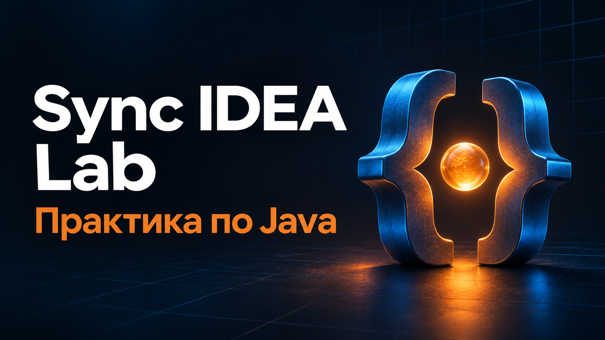

# Sync IDEA Lab



Бесплатные задачи по Java от [Sync IDEA](https://t.me/sync_idea_java). В каждой задаче есть условие, стартовый код и открытые JUnit-тесты.

[Выбрать задачу](#задачи) · [Первый запуск](#первый-запуск) · [Как отправить решение](#как-отправить-решение)

## Задачи

### Easy · с чего начать


| Задача | Навык | Время |
| --- | --- | --- |
| [SIL-002 · Какие товары нужно пополнить](challenges/java-core/SIL-002-low-stock-counter/README.md) | Массивы и условия | 15 мин |
| [SIL-003 · Приведите имя к единому виду](challenges/java-core/SIL-003-username-normalizer/README.md) | Строки и локаль | 20 мин |
| [SIL-004 · Посчитайте заказы по статусам](challenges/java-core/SIL-004-order-status-counter/README.md) | Коллекции и `enum` | 20 мин |
| [SIL-005 · Проверьте окно бронирования](challenges/java-core/SIL-005-booking-window/README.md) | Временные интервалы | 20 мин |

> [!TIP]
> Если открыли Lab впервые, начните с SIL-002. Напишите на бумаге результат для одного примера и одного граничного случая, затем сравните их с тестами.

### Middle · следующая ступень

**[SIL-001 · Одно событие — одна обработка в пределах TTL](challenges/java-core/SIL-001-idempotency-registry/README.md)**

Многопоточность, идемпотентность и время · около 90 минут. Если понравилась задача про бронирование, здесь похожая граница времени встретится в конкурентном коде.

## Первый запуск

### 1. Установите Git и JDK 21

Понадобятся [Git](https://git-scm.com/install/) и [JDK 21](https://adoptium.net/temurin/releases/?version=21).
Maven Wrapper уже в репозитории. При первом запуске он загрузит Maven и зависимости.
Аккаунт GitHub нужен, если хотите отправить решение.

```powershell
git --version
java -version
```

Если Windows выбирает другую Java, укажите путь к своему JDK 21 в PowerShell.

```powershell
$env:JAVA_HOME = 'C:\path\to\jdk-21'
$env:Path = "$env:JAVA_HOME\bin;$env:Path"
java -version
```

[Настройка IntelliJ IDEA и частые ошибки сборки](docs/getting-started.md).

### 2. Создайте форк и ветку для задачи

1. Нажмите **Fork → Create fork** в [Sync IDEA Lab](https://github.com/syncidea/sync-idea-lab). Форк — ваша копия проекта на GitHub.
2. В своём форке откройте **Code → HTTPS** и скопируйте адрес. Подставьте его вместо адреса с `ВАШ_ЛОГИН` в примере.
3. Скачайте форк и создайте ветку. В примере выбрана SIL-002. Для другой задачи используйте её ID.

```text
git clone https://github.com/ВАШ_ЛОГИН/sync-idea-lab.git
cd sync-idea-lab
git switch -c submission/SIL-002
```

### 3. Напишите решение и запустите тесты

В папке задачи откройте условие и найдите ссылку на стартовый Java-файл. Из корня репозитория
сначала проверьте компиляцию, затем запустите тесты. Пример для SIL-002 в PowerShell.

```powershell
$module = 'challenges/java-core/SIL-002-low-stock-counter'
.\mvnw.cmd --version
.\mvnw.cmd -pl $module clean test-compile
.\mvnw.cmd -pl $module clean test
```

В Linux и macOS используйте `./mvnw`. Для другой задачи возьмите точную команду из её условия.

> [!NOTE]
> `test-compile` проверяет компиляцию. `test` проверяет поведение кода. Пока метод не реализован, падение с `UnsupportedOperationException` ожидаемо.

Реализуйте метод и повторно запустите `clean test`. Если тест упал, откройте его по имени и сравните
ожидаемый результат с фактическим. Отчёты лежат внутри модуля в `target/surefire-reports`.

## Как отправить решение


1. После зелёных тестов добавьте в коммит только Java-файлы из `src/main/java` выбранной задачи.
2. Отправьте ветку в свой форк и откройте **Compare & pull request**.
3. Проверьте, что **base** — `syncidea/sync-idea-lab:main`, а **head** — ветка `submission/SIL-002` в вашем форке.

```text
git status --short
git add -- challenges/java-core/SIL-002-low-stock-counter/src/main/java
git diff --cached --name-only
git commit -m "[submission SIL-002] Подсчёт остатков"
git push -u origin submission/SIL-002
```

Заголовок PR должен начинаться с **`[submission SIL-002]`**. Подставьте ID своей задачи.
В описании укажите подход и результат тестов. [Как открыть PR из форка](https://docs.github.com/en/pull-requests/how-tos/create-pull-requests/creating-a-pull-request-from-a-fork).

На вкладке **Checks** смотрите **Submission CI → submission**. Если проверка ждёт одобрения, дождитесь запуска.

| Что видно в PR | Что делать |
| --- | --- |
| `submission` зелёный | Тесты прошли. Можно обсуждать подход в PR. |
| Шаг `Test selected challenge` красный | Откройте лог и повторите `clean test` локально. |
| Шаг `Gate paths and copy Java sources into trusted build` красный | Сверьте ID в заголовке и файлы на вкладке **Files changed**. |
| `publication-policy` красный | Для учебного PR это ожидаемо. Проверка блокирует слияние в `main`, сохраняя стартовую задачу для следующих участников. |

Чтобы исправить решение, сделайте новый коммит в той же ветке и выполните `git push`.
Учебный PR публичен и закрывается после разбора. [Правила участия](CONTRIBUTING.md) · [Сообщить об ошибке](https://github.com/syncidea/sync-idea-lab/issues/new/choose).

Код доступен по [MIT](LICENSE), тексты задач — по [CC BY 4.0](https://creativecommons.org/licenses/by/4.0/).
[Подробнее о лицензиях и авторстве](LICENSE-SCOPE.md).
